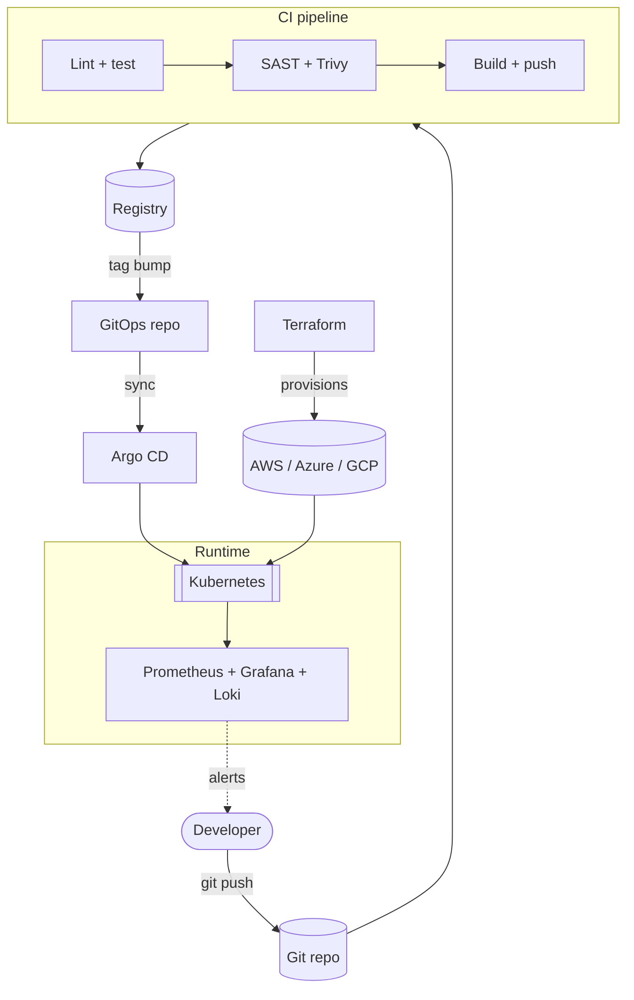

<div align="center">


# `Pavan Padamata` · Cloud & DevOps Engineer

**Infrastructure as Code · CI/CD · Kubernetes · Observability · Automation**


</div>

---

## `~/about`

```yaml
engineer:
  name: Pavan Padamata
  focus:
    - Cloud infrastructure & platform engineering
    - Declarative, reproducible, version-controlled everything
    - CI/CD pipelines with security shifted left
    - Observability-driven operations (SLIs / SLOs / alerts)
  principles:
    - "If it's not in Git, it doesn't exist"
    - "Automate the toil, document the rest"
    - "Immutable infrastructure over snowflake servers"
    - "Least privilege by default"
  currently:
    learning: [Kubernetes internals, GitOps, eBPF, FinOps]
    building: [Terraform modules, CI/CD templates, homelab cluster]
  reach_me: https://github.com/PavanPadamata
```

---

## `~/stack`

### ☁️ Cloud


### 🏗️ Infrastructure as Code & Config Management


### 📦 Containers & Orchestration


### 🔁 CI/CD


### 📊 Observability & Security


### 🧰 Languages & Systems


---

## `~/architecture`

A typical delivery flow I design and operate:



---

## `~/snippets`

<details>
<summary><b>Terraform</b> · remote state with locking</summary>

```hcl
terraform {
  required_version = ">= 1.6"

  backend "s3" {
    bucket         = "org-tf-state"
    key            = "prod/network/terraform.tfstate"
    region         = "ap-south-1"
    dynamodb_table = "tf-state-lock"
    encrypt        = true
  }
}
```
</details>

<details>
<summary><b>GitHub Actions</b> · build, scan, push</summary>

```yaml
name: ci
on:
  push:
    branches: [main]

permissions:
  id-token: write   # OIDC, no long-lived cloud keys
  contents: read

jobs:
  build:
    runs-on: ubuntu-latest
    steps:
      - uses: actions/checkout@v4
      - uses: docker/build-push-action@v6
        with:
          push: false
          load: true
          tags: app:${{ github.sha }}
      - uses: aquasecurity/trivy-action@master
        with:
          image-ref: app:${{ github.sha }}
          severity: CRITICAL,HIGH
          exit-code: 1
```
</details>

<details>
<summary><b>Kubernetes</b> · hardened deployment</summary>

```yaml
apiVersion: apps/v1
kind: Deployment
metadata:
  name: app
spec:
  replicas: 3
  strategy:
    rollingUpdate: { maxSurge: 1, maxUnavailable: 0 }
  selector:
    matchLabels: { app: app }
  template:
    metadata:
      labels: { app: app }
    spec:
      securityContext:
        runAsNonRoot: true
        seccompProfile: { type: RuntimeDefault }
      containers:
        - name: app
          image: registry.example.com/app:1.0.0
          resources:
            requests: { cpu: 100m, memory: 128Mi }
            limits:   { cpu: 500m, memory: 256Mi }
          readinessProbe:
            httpGet: { path: /healthz, port: 8080 }
          securityContext:
            allowPrivilegeEscalation: false
            readOnlyRootFilesystem: true
            capabilities: { drop: [ALL] }
```
</details>

---

## `~/stats`

<div align="center">


</div>
